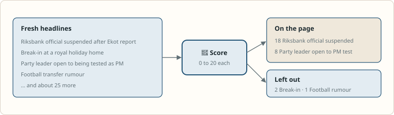

# 🧭 Techulture

A small, self-updating digest of Swedish culture and news, built from public feeds and picked partly by a local language model that runs inside GitHub Actions.

**Live page:** https://techulture.vercel.app · **Presentation with diagrams:** [presentation/index.html](presentation/index.html)

## What it does

Techulture gathers Swedish culture news in one quiet place: culture desks, art criticism and university press rooms, plus a short column of general news. It shows what was published in the last day and updates itself every hour.

Culture stories are all shown, newest first. General news is different: there is far too much of it, so a small AI reads the headlines and keeps only the few that matter most.

## How the page is made

Once an hour, a job on GitHub fetches the latest items from eleven sources, drops what is too old, lets the AI pick the news and writes one simple web page. That page is then published on Vercel. There is no database and no server: each hour the page is built again from scratch.

If a source is down, it is simply skipped for that hour. And if most sources fail at once, the old page stays up rather than being replaced by an empty one.

## A small AI that picks the news

SVT and SR Ekot publish dozens of headlines a day. The AI gets the fresh ones, about ten at a time, and gives each a score from 0 to 20: low for routine updates, sport and celebrity, high for important or surprising news that many people will want to understand. Only the top five from SVT and the top four from Ekot make it onto the page.

The AI is Qwen2.5 3B, a small open model from Hugging Face. It runs right inside the hourly GitHub job, on an ordinary processor, with no API key and no cost, and it only ever sees the headline text. If it fails to start or answer, the page simply shows the newest headlines instead. Qwen2.5 3B is released under a research licence that allows non-commercial use.

## Sources

**Culture:** SVT Kultur, SR Kulturnytt, Expressen Kultur, Kunstkritikk, Konstfack, and the universities in Stockholm, Uppsala, Lund and Södertörn.
**News:** SVT Nyheter and SR Ekot, picked by the AI.

---

*The text in this README and on the presentation page is entirely AI-generated.*
